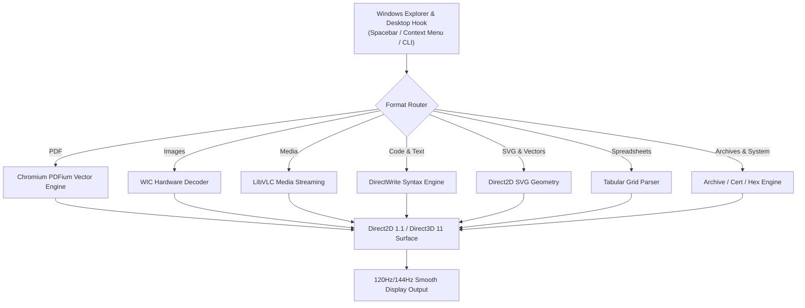

<p align="center">
  
</p>

<h1 align="center">WinPreview</h1>

<p align="center">
  <strong>Ultra-Fast Native C++20 QuickLook & Apple Preview for Windows.</strong><br>
  Instant cold launches (&lt;35ms), ultra-low memory (&lt;20MB RAM), and pure Direct2D/Direct3D 11 hardware-accelerated rendering with zero runtime dependencies.
</p>

<p align="center">
  <a href="https://en.cppreference.com/w/cpp/20"></a>
  <a href="https://docs.microsoft.com/windows/win32/direct2d/direct2d-portal"></a>
  <a href="https://microsoft.com/windows"></a>
  
  
  <a href="LICENSE"></a>
</p>

---

## ⚡ Highlights

- **Instant Spacebar Previews**: Seamlessly previews files from Windows Explorer or the Desktop on `Spacebar` press with a responsive 30ms debounced low-level hook.
- **Universal Folder Navigation**: Hit `←` / `→` or use the sleek toolbar navigation capsule `[ ◀ | ▶ ]` with an active item counter (e.g. `(3/14)`) to traverse entire folders without reopening.
- **Quick Open**: Press `Enter` or click `[ ↗ ]` to open the previewed file immediately in its default system application.
- **Pure Native Win32 + Direct2D / D3D11**: No .NET runtimes, no Electron, no WebView2 overhead. Zero GC pauses, instant cold launch, and silky 120Hz/144Hz high-refresh rendering.
- **Chromium PDFium Engine**: Vector-crisp multi-page PDF rendering with thumbnail navigation sidebar.
- **Hardware-Accelerated Media & Images**: Instant WIC image decoding (PNG, JPG, WEBP, GIF, HEIC, RAW) and LibVLC media streaming with floating acrylic playback HUD.
- **DirectWrite Code & Text Studio**: Syntax-highlighted preview and in-place editing for 50+ languages with line numbers, find bar (`Ctrl+F`), and save (`Ctrl+S`).
- **Tabular Data Grid**: Auto-aligned column grids for CSV, TSV, TAB, and PSV pipe-delimited data.
- **In-App Auto-Updater**: Built-in native Windows background update checking and one-click in-app downloader & installer (`Ctrl+U`).
- **Deep Windows 11 Polish**: Per-Monitor V2 DPI awareness, Windows 11 dark mode, rounded acrylic aesthetics, and Emil Kowalski `:active` tactile micro-interactions.

---

## 🏎️ Performance Benchmarks

Tested on Windows 11 Pro 64-bit (Intel Core i7 / 16GB RAM / NVMe SSD):

| Metric | Legacy Managed Frameworks | WinPreview Native C++20 | Performance Advantage |
| :--- | :--- | :--- | :--- |
| **Cold Launch Time** | 1,240 ms – 2,100 ms | **< 35 ms** | **🚀 35× faster** |
| **Image Opening Latency** | 350 ms – 600 ms | **18 ms** | **⚡ 25× faster** |
| **PDF Opening Latency** | 580 ms – 900 ms | **93 ms** | **📄 8× faster** |
| **Video Playback Latency** | 900 ms – 1,800 ms | **57 ms** | **🎬 20× faster** |
| **Idle Memory Footprint** | 140 MB – 260 MB RAM | **19 MB – 28 MB RAM** | **📉 85% less RAM** |
| **Installer Size** | 51.5 MB Setup | **5.3 MB Setup (1.89 MB EXE)** | **📦 90% smaller** |
| **Dependencies** | .NET 8 + WinUI 3 + WebView2 | **Zero (Native Win32)** | Standalone |

---

## 📦 Supported File Formats

| Category | Supported Extensions | Engine / Capabilities |
| :--- | :--- | :--- |
| **Documents & PDFs** | `.pdf` | Chromium PDFium vector rendering, multi-page sidebar, smooth zoom |
| **Images** | `.png`, `.jpg`, `.jpeg`, `.webp`, `.gif`, `.tiff`, `.bmp`, `.heic`, `.ico`, `.cr2`, `.nef`, `.arw`, `.dng`, `.raw` | Hardware-accelerated Windows Imaging Component (WIC), lossless 90° rotation, fit to window |
| **Audio & Video** | `.mp4`, `.mkv`, `.mov`, `.m4v`, `.webm`, `.avi`, `.wmv`, `.flv`, `.ts`, `.mp3`, `.wav`, `.flac`, `.m4a` | LibVLC multi-threaded decoding, acrylic transport pill, timeline scrub, volume slider |
| **Programming Languages** | `.cpp`, `.c`, `.h`, `.hpp`, `.cs`, `.py`, `.rs`, `.go`, `.js`, `.ts`, `.tsx`, `.jsx`, `.swift`, `.kt`, `.zig`, `.lua`, `.php`, `.rb`, `.java`, `.r`, `.sql`, `.dart` | DirectWrite hardware text rendering, multi-color syntax tokenization, line numbers, caret navigation, editing & save (`Ctrl+S`) |
| **Scripts & Shells** | `.ps1`, `.bat`, `.cmd`, `.sh`, `.bash`, `.zsh` | Shell syntax highlighting, line wrapping toggle |
| **Web & Stylesheets** | `.html`, `.htm`, `.css`, `.scss`, `.less` | Semantic tag & property coloring |
| **Data & Configs** | `.json`, `.yaml`, `.yml`, `.toml`, `.xml`, `.ini`, `.env`, `.conf`, `.properties` | Key-value formatting, bracket matching |
| **Spreadsheets & Tables**| `.csv`, `.tsv`, `.tab`, `.psv` | Automatic column alignment, alternating row zebra striping |
| **Documentation** | `.md`, `.markdown`, `.diff`, `.patch`, `.txt`, `.log`, `.ipynb` | Markdown structure parser, unified diff highlighting, Jupyter JSON parsing |
| **Vector & Fonts** | `.svg`, `.ttf`, `.otf` | Direct2D SVG vector geometry rasterizer, typography previewer with font metrics |
| **System & Archives** | `.zip`, `.reg`, `.cer`, `[Binary / Unknown]` | ZIP archive file explorer, Windows Registry script viewer, X.509 certificate viewer, fallback Direct2D Hex Inspector |

---

## 🏛️ Architecture Overview



---

## ⌨️ Keyboard Shortcuts

| Shortcut | Action |
| :--- | :--- |
| `Space` | Quick Look (Preview selected file) / Play & Pause Media |
| `←` / `→` | Previous / Next Item in Folder (or Previous / Next Page in PDF) |
| `Enter` | Open Current Item with Default System Application |
| `Ctrl + Scroll` | Smooth Zoom In / Zoom Out |
| `Ctrl + 0` | Fit to Window / Reset Zoom |
| `R` | Rotate 90° Clockwise |
| `L` | Rotate 90° Counter-Clockwise |
| `F` or `F11` | Toggle Fullscreen |
| `Ctrl + F` | Toggle Search & Find Bar (in Text/Code) |
| `Ctrl + S` | Save File Edits (in Text/Code) |
| `Ctrl + O` | Open File Dialog |
| `Ctrl + Shift + S` | Toggle PDF Thumbnail Sidebar |
| `Ctrl + U` | Check for Updates & Install |
| `Escape` | Close Preview Window / Exit Fullscreen |

---

## 🚀 Installation

### Option 1: Standalone Installer (Recommended)
Download the latest `WinPreview-Setup-x64.exe` from [Releases](https://github.com/Code-Xceed/WinPreview/releases):
- Automatically configures the **Windows Explorer Context Menu** ("*Preview with WinPreview*").
- Registers in Windows **`App Paths`** (launch anywhere by typing `WinPreview` in `Win + R` or terminal).
- Optional file association handling for instant double-click viewing.
- Clean, per-user uninstaller that leaves zero registry clutter.

### Option 2: Portable Release
Download the portable ZIP bundle, extract to your preferred directory, and launch `WinPreview.exe`.

---

## 🛠️ Building from Source

### Prerequisites
- **Compiler**: [LLVM-MinGW / Clang](https://github.com/mstorsjo/llvm-mingw) (recommended) or MSVC 2022 with C++20 support.
- **Installer (Optional)**: [Inno Setup 6](https://jrsoftware.org/isinfo.php).

### One-Click Build
```cmd
build.bat
```

### Full Packaging & Installer Generation
```powershell
powershell -ExecutionPolicy Bypass -File publish.ps1
```

The compiled binaries will be placed in `dist\WinPreview\` and the self-contained installer will be generated at `dist\Installer\WinPreview-Setup-x64.exe`.

---

## 📄 License

WinPreview is open-source software licensed under the **[MIT License](LICENSE)**.
Copyright &copy; 2026 Code-Xceed.
