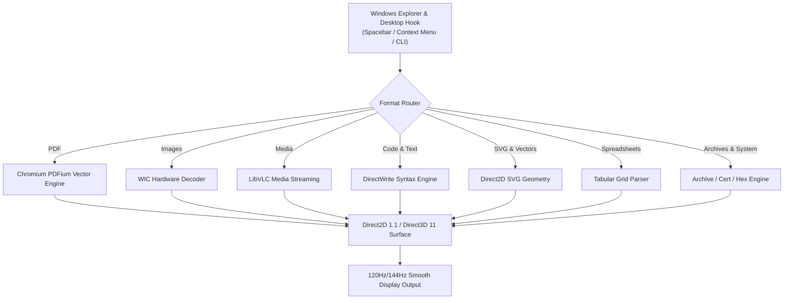

<p align="center">
  
</p>

<h1 align="center">WinPreview</h1>

<p align="center">
  <strong>Ultra-Fast Native C++20 QuickLook & Apple Preview for Windows.</strong><br>
  Instant background-service launch (~40 ms) and a ~150 ms path from a cold start to a previewed file, with a small native footprint and pure Direct2D/Direct3D 11 hardware-accelerated rendering. No .NET, Electron or WebView2 runtime is required; the native PDFium and LibHEIF components ship in the package.
</p>

<p align="center">
  <a href="https://en.cppreference.com/w/cpp/20"></a>
  <a href="https://docs.microsoft.com/windows/win32/direct2d/direct2d-portal"></a>
  <a href="https://microsoft.com/windows"></a>
  
  
  <a href="LICENSE"></a>
</p>

---

## ⚡ Highlights

- **Instant Spacebar Previews**: Seamlessly previews files from Windows Explorer or the Desktop on `Spacebar` press with a responsive 30ms debounced low-level hook.
- **Universal Folder Navigation**: Hit `←` / `→` or use the sleek toolbar navigation capsule `[ ◀ | ▶ ]` with an active item counter (e.g. `(3/14)`) to traverse entire folders without reopening.
- **Quick Open**: Press `Enter` or click `[ ↗ ]` to open the previewed file immediately in its default system application.
- **Pure Native Win32 + Direct2D / D3D11**: No .NET runtimes, no Electron, no WebView2 overhead. Zero GC pauses, instant cold launch, and silky 120Hz/144Hz high-refresh rendering.
- **Chromium PDFium Engine**: Vector-crisp multi-page PDF rendering with thumbnail navigation sidebar.
- **Hardware-Accelerated Media & Images**: Instant WIC image decoding (PNG, JPG, WEBP, GIF, HEIC, RAW) and LibVLC media streaming with floating acrylic playback HUD.
- **DirectWrite Code & Text Studio**: Syntax-tinted preview and in-place editing for 50+ languages (fast keyword / string / comment coloring, not a full parser) with line numbers, find bar (`Ctrl+F`), and save (`Ctrl+S`).
- **Tabular Data Grid**: Auto-aligned column grids for CSV, TSV, TAB, and PSV pipe-delimited data.
- **In-App Auto-Updater**: Built-in native Windows background update checking and one-click in-app downloader & installer (`Ctrl+U`).
- **Deep Windows 11 Polish**: Per-Monitor V2 DPI awareness, Windows 11 dark mode, rounded acrylic aesthetics, and Emil Kowalski `:active` tactile micro-interactions.

---

## 🏎️ Performance Benchmarks

Tested on Windows 11 Pro 64-bit (Intel Core i7 / 16GB RAM / NVMe SSD):

| Metric | Legacy Managed Frameworks | WinPreview Native C++20 | Performance Advantage |
| :--- | :--- | :--- | :--- |
| **Background Service Launch** | 1,240 ms – 2,100 ms | **~40 ms** | **30–50× faster** |
| **Cold Launch → File Previewed** | 1,240 ms – 2,100 ms | **~150 ms** | **8–14× faster** |
| **Image Opening Latency** | 350 ms – 600 ms | **~18 ms** | **20× faster** |
| **PDF Opening Latency** | 580 ms – 900 ms | **~10 ms** (first page raster follows asynchronously) | **60× faster to first paint** |
| **Video Playback Latency** | 900 ms – 1,800 ms | **~60 ms** (requires VLC) | **15–30× faster** |
| **Idle Memory Footprint** | 140 MB – 260 MB RAM | **~25–40 MB private** (working set additionally maps GPU driver pages) | **~75–85% less private memory** |
| **Installer Size** | 51.5 MB Setup | **8.7 MB Setup (1.49 MB EXE)** | **📦 83% smaller** |
| **Dependencies** | .NET 8 + WinUI 3 + WebView2 | **No managed runtime (native Win32)** | Standalone |

---

## 📦 Supported File Formats

| Category | Supported Extensions | Engine / Capabilities |
| :--- | :--- | :--- |
| **Documents & PDFs** | `.pdf` | Chromium PDFium vector rendering, multi-page sidebar, smooth zoom |
| **Images & RAW Photos** | `.heic`, `.heif`, `.avif`, `.webp`, `.png`, `.jpg`, `.jpeg`, `.gif`, `.tiff`, `.tif`, `.bmp`, `.ico`, `.cr2`, `.nef`, `.arw`, `.dng`, `.raw`, `.orf`, `.rw2`, `.pef` | Multi-tier LibHEIF + WIC hardware decoding, embedded Camera RAW preview extraction, Display P3 wide-gamut, EXIF inspector metadata |
| **Video & Audio** | `.mov`, `.mp4`, `.mkv`, `.m4v`, `.webm`, `.avi`, `.wmv`, `.flv`, `.ts`*, `.m2ts`, `.mts`*, `.mxf`, `.vob`, `.3gp`, `.ogv`, `.mp3`, `.wav`, `.flac`, `.m4a`, `.m4b`, `.aac`, `.ogg`, `.opus`, `.wma`, `.aiff`, `.ac3`, `.mka`, `.ape` | LibVLC playback when VLC 3.x is installed (or a portable `libvlc` folder next to the EXE); real-time Log-to-Rec.709 tone-mapping, acrylic transport HUD. `*` `.ts`/`.mts` are byte-sniffed: TypeScript opens in the code editor, transport streams play as video. |
| **Programming Languages** | `.cpp`, `.c`, `.h`, `.hpp`, `.cs`, `.py`, `.rs`, `.go`, `.js`, `.ts`, `.tsx`, `.jsx`, `.swift`, `.kt`, `.zig`, `.lua`, `.php`, `.rb`, `.java`, `.r`, `.sql`, `.dart` | DirectWrite hardware text rendering, fast keyword/string/comment tinting, line numbers, caret navigation, editing & save (`Ctrl+S`) |
| **Scripts & Shells** | `.ps1`, `.bat`, `.cmd`, `.sh`, `.bash`, `.zsh` | Shell syntax highlighting, line wrapping toggle |
| **Web & Stylesheets** | `.html`, `.htm`, `.css`, `.scss`, `.less` | Semantic tag & property coloring |
| **Data & Configs** | `.json`, `.yaml`, `.yml`, `.toml`, `.xml`, `.ini`, `.env`, `.conf`, `.properties` | Key-value formatting, bracket matching |
| **Spreadsheets & Tables**| `.csv`, `.tsv`, `.tab`, `.psv` | Automatic column alignment, alternating row zebra striping |
| **Documentation** | `.md`, `.markdown`, `.diff`, `.patch`, `.txt`, `.log`, `.ipynb` | Markdown structure parser, unified diff highlighting, Jupyter JSON parsing |
| **Vector & Fonts** | `.svg`, `.ttf`, `.otf`, `.woff`, `.woff2` | Direct2D SVG vector geometry rasterizer, typography previewer with font metrics |
| **System & Archives** | `.zip` (and zip-based `.jar`, `.apk`, `.nupkg`, `.vsix`, `.cbz`, `.epub` as listings), `.exe`, `.dll`, `.lnk`, `.url`, `.reg`, `.cer`, `.crt`, `.der`, `.pem`, `[Binary / Unknown]` | ZIP archive explorer, PE version/architecture cards, shortcut and certificate viewers, fallback Direct2D hex inspector |

---

## 🏛️ Architecture Overview



---

## ⌨️ Keyboard Shortcuts

| Shortcut | Action |
| :--- | :--- |
| `Space` | Quick Look (Preview selected file) / Play & Pause Media |
| `←` / `→` | Previous / Next Item in Folder (or Previous / Next Page in PDF) |
| `Enter` | Open Current Item with Default System Application |
| `Ctrl + Scroll` | Smooth Zoom In / Zoom Out |
| `Ctrl + 0` | Fit to Window / Reset Zoom |
| `R` | Rotate 90° Clockwise |
| `L` | Rotate 90° Counter-Clockwise |
| `F` or `F11` | Toggle Fullscreen |
| `Ctrl + F` | Toggle Search & Find Bar (in Text/Code) |
| `Ctrl + S` | Save File Edits (in Text/Code) |
| `Ctrl + O` | Open File Dialog |
| `Ctrl + Shift + S` | Toggle PDF Thumbnail Sidebar |
| `Ctrl + U` | Check for Updates & Install |
| `Escape` | Close Preview Window / Exit Fullscreen |

---

## 🚀 Installation

### Option 1: Standalone Installer (Recommended)
Download the latest `WinPreview-Setup-x64.exe` from [Releases](https://github.com/Code-Xceed/WinPreview/releases):
- Automatically configures the **Windows Explorer Context Menu** ("*Preview with WinPreview*").
- Registers in Windows **`App Paths`** (launch anywhere by typing `WinPreview` in `Win + R` or terminal).
- Optional file association handling for instant double-click viewing.
- Clean, per-user uninstaller that leaves zero registry clutter.

### Option 2: Portable Release
Download the portable ZIP bundle, extract to your preferred directory, and launch `WinPreview.exe`.

---

## 🛠️ Building from Source

### Prerequisites
- **Compiler**: [LLVM-MinGW / Clang](https://github.com/mstorsjo/llvm-mingw) (recommended) or MSVC 2022 with C++20 support.
- **Installer (Optional)**: [Inno Setup 6](https://jrsoftware.org/isinfo.php).

### One-Click Build
```cmd
build.bat
```

### Full Packaging & Installer Generation
```powershell
powershell -ExecutionPolicy Bypass -File publish.ps1
```

The compiled binaries will be placed in `dist\WinPreview\` and the self-contained installer will be generated at `dist\Installer\WinPreview-Setup-x64.exe`.

`publish.ps1` is the single release entry point. It synchronises the version from `version.json` into `src\version.h` and `installer\WinPreview.iss`, stages every runtime DLL, runs the production verification suite, builds the portable ZIP and installer, and writes `dist\Installer\version.json` with the installer SHA-256 used by the in-app updater.

### Production Verification

`publish.ps1` runs the local verification suite when it is present in the development tree: version consistency across `version.json`, `version.h`, the installer script and the release manifest; the x64 PE and every required runtime library; 16 representative documents rendered through the real Direct2D pipeline (`--screenshot` mode) plus Settings, Inspector and update-banner states; the scripted interaction suite; and a crash-log / orphan-process check.

CI (`.github/workflows/ci-cd.yml`) builds the installer with LLVM-MinGW and Inno Setup, verifies that the generated version files are committed, validates the artifacts and uploads them. Tagging `v*` publishes them as a GitHub Release with the installer, portable ZIP and updater manifest.

### Update Integrity

Automatic checks run at most once every two hours (manual checks via `F5` / `Ctrl+U`). The updater downloads the installer over HTTPS and verifies it against the SHA-256 and byte size published in the release manifest before executing it, rejects non-HTTPS download URLs, and validates the PE headers and Authenticode status as a second layer. A dismissed release is remembered so it cannot nag again, while a newer release re-arms normally.

---

## 📄 License

WinPreview is open-source software licensed under the **[MIT License](LICENSE)**.
Copyright &copy; 2026 Code-Xceed.
